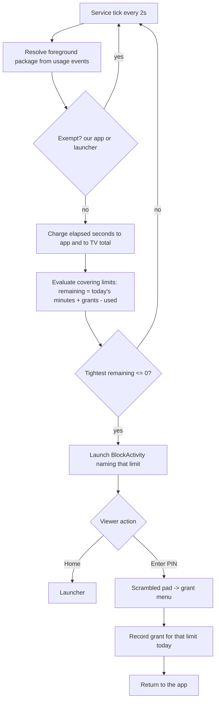

# TV App Limiter - Plan

**Target repo:** `tv-limiter` (new local repository, branch `main`, no remote). All paths below are relative to its root.

---

## Goal Capsule

- **Objective:** Whoever holds the PIN can give each app on an Android TV a daily time limit, varied by day of the week, plus a limit for the TV as a whole. When a limit runs out, the viewer hits a screen that says which limit ran out, and only someone who knows the PIN can grant more time. The PIN is entered so that someone watching the remote can't learn it.
- **Means:** One limit model covers both app limits and the whole-TV limit, and the tightest limit wins (Key Decision 1, KTD1). A foreground service polls usage stats and brings up a blocking screen (KTD3, KTD4).
- **Authority:** The Product Contract requirements (R-IDs) govern behavior. Key Technical Decisions (KTDs) govern mechanism within those requirements. Units cite both and override neither.
- **Execution profile:** One local branch, committed in logical chunks with tests and docs as the last commits. No remote, so no PR or CI. One deliverable: an installable debug APK.
- **Stop conditions:** Stop and report if the Android Gradle build can't resolve its dependencies, or if a requirement turns out to be impossible on the platform. Do not stop for the lack of an Android TV emulator: JVM tests plus a build are the bar (see Verification Contract).
- **Who finishes:** `ce-work` implements everything and runs the best-effort device smoke gate when `adb devices` reaches an emulator or TV. Setting up the owner's own TV (install and permission grants there) is left to the user.

---

## Product Contract

### Summary

A sideloaded Android TV app. The owner sets daily minute budgets per app and for the whole TV, with a separate value for each weekday. A background service counts foreground time. When any budget that covers the current app is used up, the app is replaced by a block screen that names that budget. From there, a PIN entered on a scrambled pad grants extra time to that budget for today.

### Problem Frame

The owner wants the control that TVGuard-style apps provide: a daily allowance per app that changes by weekday, and an overall TV cap. The built-in options don't do this. Google TV kids profiles reportedly have no per-app time limits, and Android TV restricted profiles only block apps outright. Existing limiters ask for a PIN in front of the person being limited, and a PIN typed on a visible keypad can be learned by watching.

### Actors

- A1. Owner: holds the PIN, configures limits, grants extra time.
- A2. Viewer: uses the TV and gets blocked when a budget runs out. Doesn't know the PIN.

### Key Decisions

- KD1. **One limit model, tightest wins.** A limit is a scope (one app, or the whole TV) with a seven-day minutes table. A minute of use counts against every limit that covers the app. The limit with the least time left decides when to block. (session-settled: user-approved, chosen over separate per-app and whole-TV timers: the user wants whole-TV limits "with the same customization options", and separate timers duplicate every feature and cause blocks nobody can explain.) Governs R1, R3, R4, R6, R10.
- KD2. **The override grants an amount chosen by the owner, to the limit that fired, for today only.** The choice is between a fixed menu and "rest of day" only. The menu keeps "yes" small without banning it. Governs R10.

### Requirements

**Limits and schedules**

- R1. The owner can pick any launchable installed app and give it a limit.
- R2. Each limit has a minutes value for each of the seven weekdays. Any day can be set to "no limit".
- R3. One whole-TV limit exists, with the same weekday table and override behavior as an app limit. It counts all foreground time except the exempt apps in R6.
- R4. Every foreground minute counts against every enabled limit that covers the app (KD1). The limit with the least remaining time is the one that blocks.
- R5. Usage and grants reset at local midnight. Each day's limit comes from that weekday's value.

**Time-up and override**

- R6. When an enabled limit covering the foreground app reaches zero, the app is covered within a few seconds by a block screen naming that limit (the app's name, or "TV time"). Exempt from blocking and from counting: this app itself and the home launcher.
- R7. From the block screen, the viewer can only go home or ask for the PIN. Leaving the block screen never resumes the blocked app.
- R8. A PIN of 4 to 8 digits is created on first launch. The PIN is needed to open the limits settings, and every grant needs it too.
- R9. PIN entry is masked. The field shows an arrow glyph for each digit entered and never shows the digits. Digits are chosen on a pad whose order is reshuffled every time it opens, with the cursor starting on a random digit and jumping to a random digit after each confirm. A remote press therefore doesn't reveal which digit was chosen.
- R10. After a correct PIN on the block screen, the owner chooses +15 min, +30 min, +60 min, or rest of today. The grant applies only to the limit that fired, and only for today (KD2).
- R11. After 5 wrong PINs in a row, PIN entry is locked for 60 seconds.

**Running reliably**

- R12. Tracking starts on its own after a reboot, and keeps the time already used today.
- R13. The settings screen shows whether usage access and "display over other apps" are granted. It opens the matching system screen and also shows the `adb` command to grant each one, since some TV builds hide those screens.

### Acceptance Examples

- AE1. **Covers R4, R6.** Given YouTube has a 60-minute Tuesday limit and the TV has a 180-minute Tuesday limit, and 50 minutes of YouTube plus 120 minutes of other apps have been used today: after 10 more YouTube minutes both limits reach zero together, and the block screen says "YouTube is done for today" (a tie names the app limit). Opening any other app then shows "TV time is used up".
- AE2. **Covers R10.** Given the YouTube limit fired and the owner grants +30 min, YouTube plays for 30 more minutes. The TV limit is unchanged, so if the TV limit runs out first, the block screen names TV time.
- AE3. **Covers R2, R5.** Given a limit with Saturday set to "no limit", the app is never blocked by that limit on Saturday. At Sunday 00:00 its Sunday value applies, starting from zero minutes used.

### Scope Boundaries

**Non-goals (considered and not built):**

- Clock-change resistance. Setting the TV clock forward starts a new day's budget early. Hardening this (ideation idea I6) needs network time and replaying usage events, and the owner would notice a wrong clock on the TV. Reconsider if this bypass shows up in practice.
- Device Admin or device-owner uninstall protection. Device Admin can be revoked in two taps from settings, so it would be protection in name only. Device owner needs a factory reset to set up. Reconsider for a locked-down deployment.
- Blocking our own settings or the launcher when TV time is used up. Exempting them keeps a way back to the PIN.

**Deferred to Follow-Up Work:**

- Warnings before time runs out, and a short grace period to finish an episode (ideation I5).
- App groups sharing one budget. These fit the model as another scope value, but need their own picker UI.
- Bedtime windows (a time-of-day lockout using the same weekday table).
- One-time override codes and recovery codes (ideation I7), and a forgotten-PIN path. Until that exists, recovery means clearing the app's data through `adb`, which also clears the limits.

### Assumptions

- The PIN holder (A1) is not the person being limited (A2).
- Whole-TV time counts every non-exempt foreground app, including system apps like Settings.
- A day starts at local midnight (R5). No custom reset hour.
- Distribution is a sideloaded debug or release APK. Play Store policy is out of scope.
- The masked pad protects against someone watching the remote and against learning a fixed pattern. It can't stop a person who watches the screen closely during entry, since the pad has to show digits to the owner.

### Sources

- Ideation and its research: `docs/ideation/2026-11-11-android-tv-app-limiter-ideation.html` (ideas I1 and I2 adopted, I3 adapted to a fixed menu).
- Moving-cursor directional PIN entry: Springer, Artificial Life and Robotics, doi 10.1007/s10015-023-00890-y. Scrambled keypads: arXiv 1908.09165.
- TVGuard listing (Usage Access plus a PIN lock screen): apkcombo.com/tvguard-parental-control-tv/com.revaltronics.tvguard.agent.

---

## Planning Contract

### Key Technical Decisions

- KTD1. **Domain logic is plain Kotlin with no Android imports.** The limit model, evaluation, usage counting, grants, PIN hashing and pad state live under `domain/` and run as JVM unit tests. There's no TV emulator here, so JVM tests are the main proof that the behavior is right.
- KTD2. **Persistence is JSON files through kotlinx.serialization, with one file each for limits, today's usage, and the PIN record.** The data is small and read whole. Room would add a schema and migrations for no benefit, and SharedPreferences can't be tested on the JVM. Writes go to a temp file and are then renamed over the original, so a crash can't leave half a file.
- KTD3. **The foreground app is found by polling `UsageStatsManager.queryEvents` from a foreground service every 2 seconds.** A resumed event sets the current package, and a paused event with no later resumed event clears it. The other option, an AccessibilityService, risks Play policy problems and has no clear benefit for a sideloaded app. Time is added from `SystemClock.elapsedRealtime` deltas, capped at 2 polling intervals per tick, so a stalled service doesn't count a long gap twice. The service type is `specialUse` on API 34 and later. (Governs mechanism for R4, R6, R12.)
- KTD4. **Blocking launches a full-screen `BlockActivity` from the service, allowed by the "display over other apps" permission.** Android 10 and later only allow a background activity launch when that permission is granted. That is also the permission the platform already associates with this kind of app. BlockActivity runs in its own task and excludes itself from recents. Back and Home both send the viewer to the launcher (R7).
- KTD5. **Views with standard focus handling, not Compose.** A handful of D-pad screens don't justify the Compose compiler and TV-material dependencies. Standard focusable views handle remote input well.
- KTD6. **PIN storage is PBKDF2-HMAC-SHA256 with a random 16-byte salt and 120,000 iterations,** using the JDK's own crypto, so the domain test can check it on the JVM.
- KTD7. **Build setup:** Android Gradle Plugin 8.13.2, Kotlin 2.0.21, Gradle wrapper 8.13 (all already in the local Gradle cache), compileSdk 36, targetSdk 34, minSdk 26. Build with Android Studio's bundled JDK 21, because the system default is JDK 8.

### High-Level Technical Design

Each polling tick, the service charges the elapsed time to the foreground app and then checks every limit that covers it.



Limit model sketch (shape only, not an implementation spec):

```text
Limit      = { id, scope: App(package) | WholeTv, minutesByDay: Mon..Sun -> minutes | none, enabled }
DayUsage   = { date, secondsByPackage, tvSeconds, grantsByLimitId: minutes | restOfDay }
remaining(limit, day) = minutesByDay[day.weekday] * 60 + grantMinutes * 60 - usedSeconds(scope)   (all in seconds)
blocking(pkg) = covering limits with remaining <= 0, smallest remaining first
```

### Output Structure

```text
settings.gradle.kts, build.gradle.kts, gradle/ (wrapper), gradle.properties
app/build.gradle.kts
app/src/main/AndroidManifest.xml
app/src/main/java/dev/tvlimiter/
  domain/        limits, evaluator, usage ledger, grants, pin hasher, pin pad state
  data/          JSON file stores
  service/       tracking service, foreground resolver, boot receiver
  ui/            settings, app picker, schedule editor, pin pad view, block screen, pin setup
app/src/main/res/  layouts, strings, banner, theme
app/src/test/java/dev/tvlimiter/  JVM tests
```

### Sequencing

U1 first. U2 and U4 are independent after U1. U3 needs U2. U5 needs U2 and U3. U6 needs U4 and U5. U7 needs U2 to U5. U8 comes last.

---

## Implementation Units

### U1. Project scaffold for an Android TV app

- **Goal:** A building Kotlin Android TV project that launches from the TV home screen.
- **Requirements:** Base for all of them.
- **Dependencies:** none.
- **Files:** `settings.gradle.kts`, `build.gradle.kts`, `gradle.properties`, `gradle/wrapper/gradle-wrapper.properties`, `gradlew`, `gradlew.bat`, `app/build.gradle.kts`, `app/src/main/AndroidManifest.xml`, `app/src/main/res/values/strings.xml`, `app/src/main/res/values/themes.xml`, `app/src/main/res/drawable/banner.xml`, `.gitignore`, `ui/SettingsActivity.kt` (a minimal placeholder that U7 replaces).
- **Approach:**
  1. Set the versions from KTD7. Add the kotlinx.serialization plugin and JSON library, and JUnit 4 for tests.
  2. Manifest: `LEANBACK_LAUNCHER` and `LAUNCHER` intent filters on the placeholder `SettingsActivity`, a TV banner, touchscreen marked as not required, and leanback marked as not required so the APK also installs on a phone emulator for smoke checks.
- **Execution note:** Mostly packaging. Prove it with a successful `assembleDebug`, not unit tests.
- **Test expectation:** none, scaffolding only.
- **Verification:** `./gradlew assembleDebug` produces an APK.

### U2. Limit model and evaluator

- **Goal:** Pure-Kotlin limits, weekday schedules, and the tightest-wins evaluation.
- **Requirements:** R2, R3, R4, R5, R10 (grant arithmetic), KD1, KD2.
- **Dependencies:** U1.
- **Files:** `app/src/main/java/dev/tvlimiter/domain/Limit.kt`, `domain/LimitEvaluator.kt`, `domain/DayUsage.kt`, test `app/src/test/java/dev/tvlimiter/domain/LimitEvaluatorTest.kt`.
- **Approach:** `Limit` and `DayUsage` follow the sketch in High-Level Technical Design. The evaluator takes the limits, today's usage, the weekday and a package. It returns the covering limits with their remaining seconds and the blocking limit, if any. A "rest of day" grant makes that limit's remaining time unlimited. Disabled limits and "no limit" days never block.
- **Test scenarios:**
  - Covers AE1. App limit at 60 min and TV at 180 min: 60 min app use blocks on the app limit, and 180 min total blocks other apps on the TV limit.
  - Both limits exhausted: the one with the lower remaining time is reported. Ties prefer the app limit, because its name is more specific.
  - Covers AE2. +30 grant on the app limit adds 30 min to it only, and the TV limit's remaining time is unchanged.
  - A rest-of-day grant means that limit never blocks for the rest of the day.
  - Covers AE3. A "no limit" day never blocks.
  - A disabled limit never blocks.
  - An app with no app limit is governed by the TV limit alone.
  - A package with zero covering limits returns no block.
- **Verification:** The evaluator tests pass. The evaluator has no Android imports.

### U3. Usage ledger, day rollover, and JSON stores

- **Goal:** Count seconds per package and for the TV, reset at local midnight, and persist limits and usage.
- **Requirements:** R4, R5, R12.
- **Dependencies:** U1, U2.
- **Files:** `domain/UsageLedger.kt`, `data/JsonFileStore.kt`, `data/LimitsRepository.kt`, `data/UsageRepository.kt`, tests `app/src/test/java/dev/tvlimiter/domain/UsageLedgerTest.kt`, `app/src/test/java/dev/tvlimiter/data/JsonFileStoreTest.kt`.
- **Approach:**
  1. The ledger's `charge(package, seconds, now)` charges both the package bucket and the TV bucket. If `now` falls on a new local date, it starts a fresh `DayUsage` before charging. The injected clock and zone make this testable.
  2. The stores write atomically per KTD2. A missing file means defaults: no app limits, and a whole-TV limit that exists but is disabled. A corrupt file is renamed aside and replaced with defaults instead of crashing the service.
  3. `UsageRepository`, `LimitsRepository` and `PinRepository` are process-wide singletons holding the only in-memory copy, with writes guarded by a lock. The service, the block screen and the settings screens all read and change state through them, and the service reads current limits on every tick instead of caching its own copy. This keeps a grant or a limit edit from being overwritten by the service's next save.
- **Test scenarios:**
  - Charging 30 s to package A adds 30 s to A and to the TV total.
  - The first charge after midnight starts the new date at zero, and grants from yesterday are gone.
  - Usage written and then read back is identical. Limits round-trip including "no limit" days.
  - A missing file gives defaults. A corrupt file gives defaults and leaves a `.corrupt` copy.
- **Verification:** The ledger and store tests pass. Restarting the process keeps today's usage (R12), because the service reads the persisted ledger.

### U4. PIN hashing and the scrambled arrow pad

- **Goal:** Secure PIN storage, lockout, and the masked pad's state logic plus its view.
- **Requirements:** R8, R9, R11.
- **Dependencies:** U1.
- **Files:** `domain/PinHasher.kt`, `domain/PinGuard.kt`, `domain/ScrambledPadState.kt`, `data/PinRepository.kt`, `ui/PinPadView.kt`, `app/src/main/res/layout/view_pin_pad.xml`, tests `app/src/test/java/dev/tvlimiter/domain/PinHasherTest.kt`, `domain/PinGuardTest.kt`, `domain/ScrambledPadStateTest.kt`.
- **Approach:**
  1. `PinHasher` follows KTD6 and compares in constant time.
  2. `PinGuard` counts consecutive failures and locks for 60 s after 5 (R11), using an injected clock. The failure count and the lockout end are stored in the PIN record (KTD2) and shared by every PIN prompt, so leaving the screen or switching from the block screen to the settings gate doesn't reset them. The lockout is measured with `elapsedRealtime`, so changing the wall clock doesn't end it (after a reboot the stored lockout is treated as a fresh 60 s).
  3. `ScrambledPadState` holds the digit order (a permutation of 0 to 9), the cursor index, and the entered digits. The row has 12 cells: the 10 shuffled digits, then fixed Delete and Done cells. Left and right move the cursor across all 12, wrapping at the ends. OK on a digit appends it (ignored at 8 digits), then moves the cursor to a random other digit cell. OK on Delete removes the last digit. OK on Done submits, and is inactive below 4 digits. The display string is one arrow glyph (`▲`) per entered digit. It uses an injected `Random`.
  4. `PinPadView` draws the 12 cells from the state, the arrow field, and one feedback line under it. It handles D-pad keys and reports submitted entry. The feedback line is shared by setup, the settings gate and the block screen: a wrong PIN clears the entry, reshuffles the pad and shows "Wrong PIN, N tries left". A lockout shows "Try again in Ns" with a live countdown and accepts no entry. Back on the pad clears the entry, and a second Back leaves the pad.
- **Test scenarios:**
  - The correct PIN verifies, a wrong PIN fails, and the same PIN with two salts gives different hashes.
  - 5 failures lock entry, the 6th attempt within 60 s is refused without checking, and entry is allowed again after 60 s. A success resets the count.
  - Two pads opened with different seeds have different digit orders. The cursor starts at the index the seeded `Random` gives.
  - Pressing OK enters the digit under the cursor, and the cursor then moves to a different index.
  - The display shows one arrow per entered digit and never contains a digit character.
  - Delete on an empty entry does nothing. Done below 4 digits does nothing. A 9th digit is ignored.
  - After OK on a digit, the cursor lands on a digit cell, never on Delete or Done.
  - After 5 failures, a new `PinGuard` built from the stored record still refuses the 6th attempt.
- **Verification:** The PIN tests pass. On a device, the field shows only arrows.

### U5. Tracking service, foreground resolver, and boot start

- **Goal:** Count foreground time and launch the block screen when the tightest covering limit reaches zero.
- **Requirements:** R4, R6, R12.
- **Dependencies:** U2, U3.
- **Files:** `service/ForegroundResolver.kt`, `service/TrackingService.kt`, `service/TickAccountant.kt`, `service/BootReceiver.kt`, `service/ExemptPackages.kt`, `AndroidManifest.xml` (service, receiver, permissions `PACKAGE_USAGE_STATS`, `SYSTEM_ALERT_WINDOW`, `FOREGROUND_SERVICE`, `FOREGROUND_SERVICE_SPECIAL_USE`, `RECEIVE_BOOT_COMPLETED`, and a `<queries>` block for `ACTION_MAIN` with `CATEGORY_LAUNCHER`, `CATEGORY_LEANBACK_LAUNCHER` and `CATEGORY_HOME`, without which targetSdk 34 package visibility hides the apps the picker lists, the home package, app labels and relaunch intents), tests `app/src/test/java/dev/tvlimiter/service/ForegroundResolverTest.kt`, `service/TickAccountantTest.kt`.
- **Approach:**
  1. `ForegroundResolver` is a pure function over a list of (package, event type, time) records, which keeps it JVM-testable. The service adapts `UsageEvents` into that list. On the first tick after the service starts, it queries the last 6 hours instead of the last poll window, so a restart while an app is already open still finds it.
  2. `TickAccountant` turns elapsed-realtime deltas into charged seconds with the KTD3 cap. It skips exempt packages: this app, and the resolved default home package.
  3. On each tick the service charges, saves, and evaluates. When there's a blocking limit and BlockActivity isn't already showing for that package, it launches BlockActivity with the limit id and package.
  4. `BootReceiver` and the settings screen both start the service. The notification channel uses low importance.
- **Test scenarios:**
  - Events A resumed then B resumed give B. A resumed then A paused, with nothing after, gives no foreground app.
  - An empty event window keeps the previous foreground package.
  - With no previous state, a seed window whose latest event is A resumed gives A.
  - A 2 s delta charges 2 s. A 600 s delta after a stall charges at most 4 s. A negative delta (after a reboot) charges 0.
  - Exempt packages are never charged.
  - Integration, on a device or by hand: with a 1-minute limit on an app, the block screen appears within about 3 s of the minute ending.
- **Verification:** The resolver and accountant tests pass. The service runs after a reboot.

### U6. Block screen and override flow

- **Goal:** The screen that names the fired limit and handles Home, PIN entry and the grant.
- **Requirements:** R6, R7, R9, R10, R11, KD2.
- **Dependencies:** U4, U5.
- **Files:** `ui/BlockActivity.kt`, `ui/BlockViewModel.kt`, `ui/GrantChoice.kt`, `app/src/main/res/layout/activity_block.xml`, test `app/src/test/java/dev/tvlimiter/ui/BlockViewModelTest.kt`.
- **Approach:** `BlockViewModel` is plain Kotlin. It turns a limit id and today's usage into the headline: "<App> is done for today" or "TV time is used up". It drives the steps: choose → PIN → grant menu → apply grant through `UsageRepository`. After a grant, if another covering limit is also at zero (the AE1 tie), the screen switches to that limit's headline and goes straight to its grant menu without asking for the PIN again, since the owner just entered it. Each grant still applies only to the limit it was chosen for (KD2). Once nothing covering the package is at zero, the app relaunches the blocked package. Home and Back go to the launcher. The activity uses `excludeFromRecents` and `singleInstance`.
- **Test scenarios:**
  - An app limit gives the app-name headline. The TV limit gives "TV time is used up".
  - A correct PIN moves to the grant menu. A wrong PIN stays on the pad and counts toward R11.
  - Choosing +15 records 15 min for that limit id only.
  - Rest of day records an unlimited grant for that limit.
  - While locked out, the pad shows "Try again in Ns" and accepts no entry. A wrong PIN shows "Wrong PIN, N tries left".
  - AE1 tie: after +30 on the YouTube limit, the screen moves to the TV limit's grant menu with no second PIN, and the TV limit's grant is recorded separately.
- **Verification:** The view model tests pass. Back never resumes the blocked app.

### U7. Settings: PIN setup, limits list, app picker, weekday editor, permission status

- **Goal:** The owner-facing screens, all reachable with the remote.
- **Requirements:** R1, R2, R3, R8, R13.
- **Dependencies:** U2, U3, U4, U5.
- **Files:** `ui/SettingsActivity.kt`, `ui/SettingsUnlock.kt`, `ui/PinSetupActivity.kt`, `ui/PinGateActivity.kt`, `ui/AppPickerActivity.kt`, `ui/ScheduleEditorActivity.kt`, `ui/ScheduleEditorState.kt`, `ui/PermissionStatus.kt`, layouts under `app/src/main/res/layout/`, test `app/src/test/java/dev/tvlimiter/ui/ScheduleEditorStateTest.kt`.
- **Approach:**
  1. On launch the settings screen starts `TrackingService`. With no PIN stored, the app goes to PIN setup (enter twice on the scrambled pad; a mismatch returns to the first entry with "PINs did not match"). Otherwise it goes through the PIN gate to the settings screen. The unlock lives only in memory (`SettingsUnlock`) and is cleared when the settings task goes to the background. Every settings activity checks it in `onStart` and sends the user to the PIN gate when it is not set, so resuming from recents or from a launcher app always asks for the PIN.
  2. The settings screen lists the whole-TV limit first, then app limits with today's used and remaining time. It has an "Add app limit" button and a permissions panel.
  3. The app picker lists launchable apps from both the leanback and the normal launcher intents, sorted by today's usage and then by name, excluding this app.
  4. The schedule editor has 7 day rows. Left and right change minutes in 15-minute steps, with a step below 0 meaning "no limit". It has buttons for "Copy Monday to weekdays", "Copy Saturday to weekend", Enable/Disable and Delete. The logic lives in `ScheduleEditorState`.
  5. The permissions panel shows the granted state, a button to the system screen, and the `adb shell appops set dev.tvlimiter <OP> allow` text for usage stats and overlay (R13).
- **Test scenarios:**
  - Right from 45 gives 60. Left from 0 gives "no limit". Right from "no limit" gives 15.
  - The maximum is 24 h, and pressing right at 24 h stays at 24 h.
  - Copy Monday to weekdays sets Tue to Fri to Monday's value and leaves the weekend alone.
  - Copy Saturday to weekend sets Sunday only.
  - `SettingsUnlock`: unlocked, then backgrounded, then started again reports locked.
- **Verification:** The editor state tests pass. Every screen can be fully operated with D-pad and OK.

### U8. README with setup and grant steps

- **Goal:** The owner can install, grant permissions, and understand what the app protects against and what it doesn't.
- **Requirements:** R13, Scope Boundaries.
- **Dependencies:** U1 to U7.
- **Files:** `README.md`.
- **Approach:** Cover building with JDK 21, installing with `adb install`, the two `appops` grant commands, the first-run PIN, what is exempt, the known limits from the non-goals, and recovery by clearing app data. Also cover: turn off USB and network debugging (and developer options) after the grants, because leaving them on lets anyone on the network clear or edit the app's data; the pad hides the PIN from someone watching the remote but not from someone watching the TV screen, so enter it out of the viewer's sight; and from the TV's own Settings, Clear storage (which resets the PIN), Force stop, or revoking usage access or overlay will defeat the limiter.
- **Test expectation:** none, documentation only.
- **Verification:** A new reader can go from clone to working limits using the README alone.

---

## Verification Contract

| Gate                       | Command                                                                                             | Applies to                                        |
| -------------------------- | --------------------------------------------------------------------------------------------------- | ------------------------------------------------- |
| Build                      | `JAVA_HOME="/Applications/Android Studio.app/Contents/jbr/Contents/Home" ./gradlew assembleDebug`   | every unit                                        |
| Unit tests                 | `JAVA_HOME=... ./gradlew testDebugUnitTest`                                                         | U2 to U7                                          |
| Lint                       | `JAVA_HOME=... ./gradlew lintDebug` (no new errors)                                                 | final                                             |
| Device smoke (best effort) | If `adb devices` reaches an emulator or TV: install, grant `GET_USAGE_STATS` and `SYSTEM_ALERT_WINDOW` with `adb shell appops set`, launch PIN setup, set a 1-minute limit on a test app, and confirm BlockActivity appears | final, skipped and reported when no device exists |

## Definition of Done

- Every unit's verification holds. The build, unit tests and lint pass with the JDK 21 command above.
- Every requirement R1 to R13 is covered by a unit, and AE1 to AE3 are covered by evaluator tests.
- No code from abandoned approaches remains in the diff.
- The README matches the shipped behavior and states the non-goals.

## Open Questions (from document review, for the owner)

These touch the Product Contract or need the user's answer, so they were not changed in the plan. The build follows the plan as written.

- **Tampering through the TV's own Settings.** Clear storage resets the PIN (the next launch offers setup to whoever holds the remote), and Force stop or revoking usage access or overlay stops tracking. Settings is never blocked until TV time runs out, and the Deferred item's "through `adb`" understates how easy clearing data is. Options: put the system Settings package behind the PIN (block screen with a PIN prompt), let the picker offer Settings for a 0-minute limit, or accept it as a non-goal. For now the README documents it.
- **Which arrow masking was meant.** R9 shows one arrow per entered digit in the field. The user may instead have meant digits assigned to D-pad directions, so that the entry itself is a sequence of arrow presses. Confirm before more work goes into the pad.
- **The screen is visible to the viewer.** The pad highlights the chosen digit cell on screen, so someone watching the TV can read the PIN. A stronger pad would hide cell labels while the cursor moves. For now the README says to enter the PIN out of sight.
- **R4 versus the stall cap.** KTD3 drops time beyond 2 polling intervals after a service stall, while R4 says every minute counts. The cap was kept. Say if stall time should be charged instead.
- **FYI (not acted on):** a one-time "5 minutes left" Toast (cheap, part of deferred I5); exempting the screensaver and skipping charges while the screen is off; stopping picture-in-picture or background audio from a blocked app; dropping the per-limit `enabled` flag in favor of all-"no limit" days; hold-to-repeat in the schedule editor; lint's `ExpiredTargetSdkVersion` check may need disabling for a sideloaded targetSdk 34 build. The scope reviewer's proposal to drop the copy-day buttons was not taken, because the design reviewer found the editor already needs too many presses.
